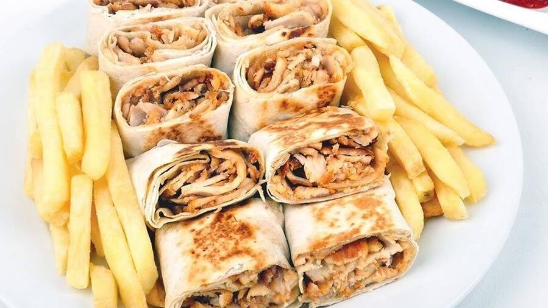
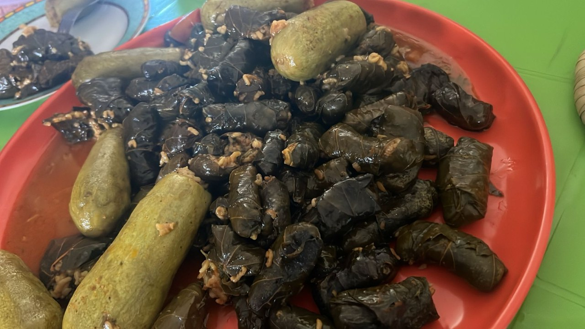
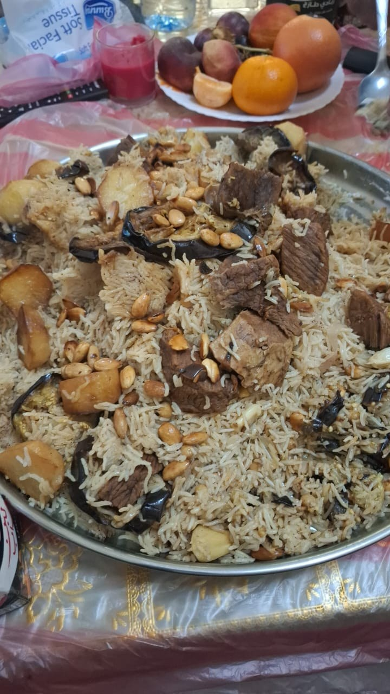
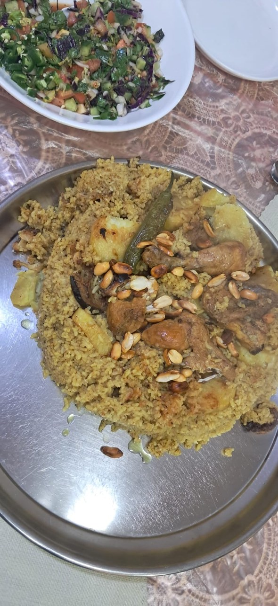

# Smart Diet

**Food image detection for Jordanian and Arabic cuisine, with a proposed calorie-tracking workflow.**

The project explores identifying dishes in meal photos and supporting a daily food log. Its presentation describes profile setup, meal recognition, calorie tracking, daily reports, and recommendations. The Colab notebook contains a YOLOv8s food-detection training run and saved evaluation output.

> **What this repository contains:** the project presentation, the main training notebook with its recorded output, the class configuration, and a few sample prediction inputs. The full food dataset, trained `.pt` checkpoint, and Streamlit/SQLite application source were not included in the shared Drive material. The notebook therefore cannot be rerun end-to-end from this repository alone.

## Food classes

The detector configuration lists 20 classes: Pizza, Mansaf, Mjadra, Maqluba, Fasolia, Awameh, Salad, Molokhia, Shawarma, Macaroni, Burger, Kunafa, Dawali, Kabsa, Msakan, Qatayif, Cucumber with Yogurt, Mahashi, Coleslaw Salad, and Muhalabia.

## Recorded model results

The final notebook records a YOLOv8s run of 130 epochs at 960-pixel image size, followed by a separate evaluation output. The recorded evaluation reports **80.9% mAP@0.50**, **64.7% mAP@0.50:0.95**, **74.2% precision**, **83.5% recall**, and **78.6% F1** on 825 images containing 786 annotated instances; 304 images were backgrounds.

The notebook also records a training-cell summary of 88.8% mAP@0.50 and 69.7% mAP@0.50:0.95 over 8,615 images and 9,798 instances. These are the notebook's outputs, not results reproduced in this repository. See the [full evaluation notes and per-class metrics](docs/model-evaluation.md).

**Read the evaluation caveat before interpreting these numbers:** the shared `data1.yaml` currently points both `train` and `val` to the same `food` directory, while the evaluation output scans a `test.cache` file. The training cell saves `Model/YOLO_Trained_Model.pt`, but the later evaluation cell loads `final_version.pt`. The data split and checkpoint used for each output therefore need confirmation before these metrics can be treated as a verified held-out benchmark.

## Sample prediction inputs

These are four sample photos from the shared `Data_prediction` folder. They are **input images**, not annotated model outputs; the shared folder did not contain rendered prediction overlays or the model checkpoint needed to recreate them.

| Sample 1 | Sample 2 |
| --- | --- |
|  |  |
|  |  |

## Notebook and configuration

- [Open the main Colab notebook](https://colab.research.google.com/github/omar-salem23/smart-diet/blob/main/notebooks/Omar_Final_Project.ipynb). Running it requires the original dataset and checkpoint in Drive, and the paths/splits should be checked first.
- [`notebooks/Omar_Final_Project.ipynb`](notebooks/Omar_Final_Project.ipynb) — YOLOv8s training, evaluation, and notebook outputs.
- [`configs/data1.drive.yaml`](configs/data1.drive.yaml) — the configuration copied from Drive, including its Drive-specific paths.
- [`configs/data1.example.yaml`](configs/data1.example.yaml) — a portable template with separate train, validation, and test directories.
- [`docs/Smart_Diet_Project_Presentation.pdf`](docs/Smart_Diet_Project_Presentation.pdf) — the original 14-page project presentation.

The presentation proposes **Ultralytics YOLO**, **SQLite**, and **Streamlit** for a future application. The notebook uses Python, Ultralytics, OpenCV, and Matplotlib. No runnable application code or trained checkpoint is included here.

## Project previews

| Application flow | Interface concept |
| --- | --- |
|  |  |

## Credits

Names listed in the presentation: **Omar Salem**, **Mohammed Abufurha**, **Hamzeh Haloub**, and **Dr. Ahmad Al-Smadi**.

## Nutrition note

Calorie estimates depend on dish recognition, portion size, and validated nutrition data. The equations and recommendations in the presentation need review by a qualified nutrition professional before use. Smart Diet is an educational project, not medical or nutrition advice.
