# Smart Diet

**Food detection for Jordanian and Arabic cuisine, with a proposed calorie-tracking workflow.**

Smart Diet explores how meal photos could support dish recognition and food logging. This repository brings together the project presentation, a YOLOv8s training notebook, its recorded evaluation, and example prediction images.

> **Project status:** The shared materials do not include the complete food dataset, trained `.pt` checkpoint, or Streamlit/SQLite application source. The notebook and evaluation history are documented here, but the training run cannot be reproduced end to end from this repository alone.

## Prediction examples

These 11 annotated images show sample detections and confidence scores. They are qualitative examples; the notebook-reported benchmark below is a separate evaluation output.

| **Fasolia · 0.67** | **Shawarma · multiple detections** |
| --- | --- |
| 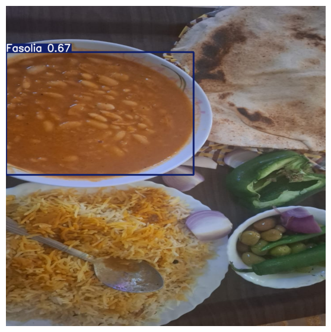 | 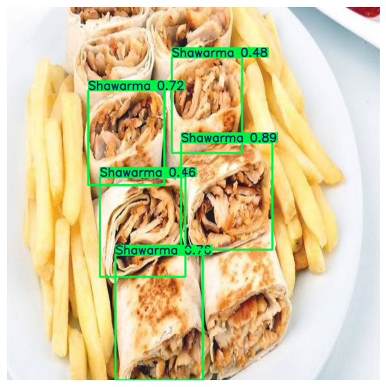 |

| **Molokhia · 0.89 and 0.90** | **Awameh · 0.80** |
| --- | --- |
| 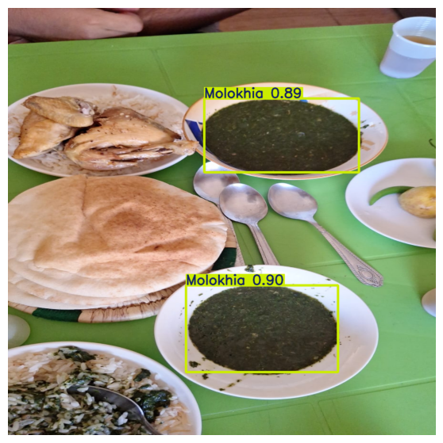 | 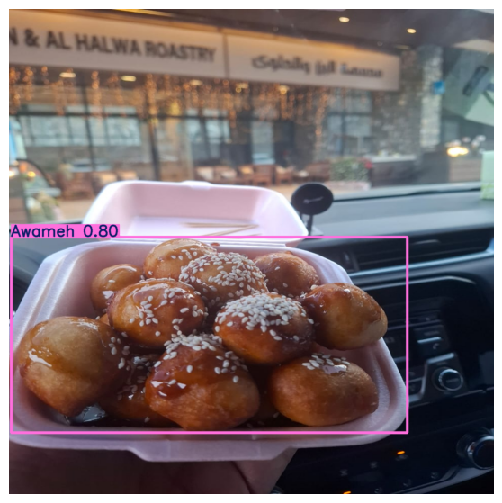 |

| **Macaroni · 0.82 and 0.88** | **Maqluba · 0.77** |
| --- | --- |
| 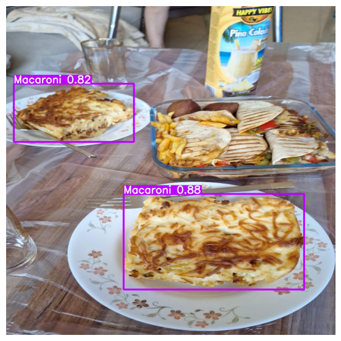 | 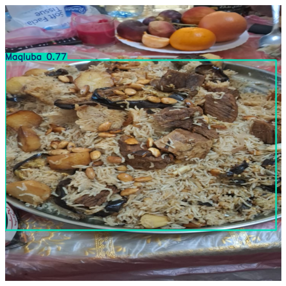 |

| **Mansaf · 0.74** | **Mjadra · 0.68** |
| --- | --- |
| 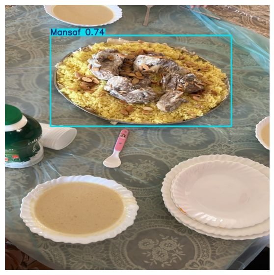 | 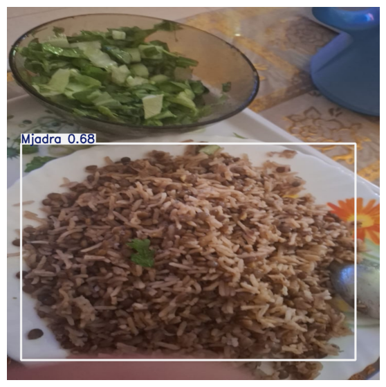 |

| **Mjadra · 0.84** | **Mahashi and Dawali · multiple detections** |
| --- | --- |
| 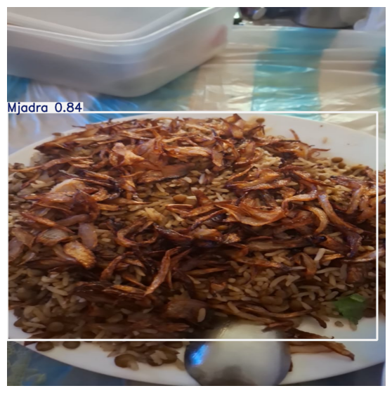 | 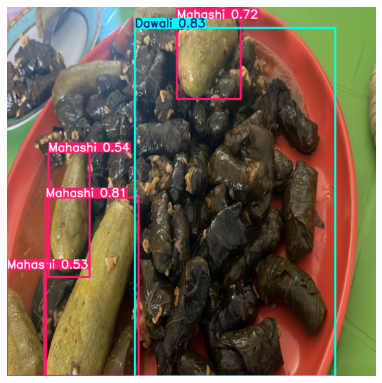 |

| **Msakan · 0.84** | |
| --- | --- |
| 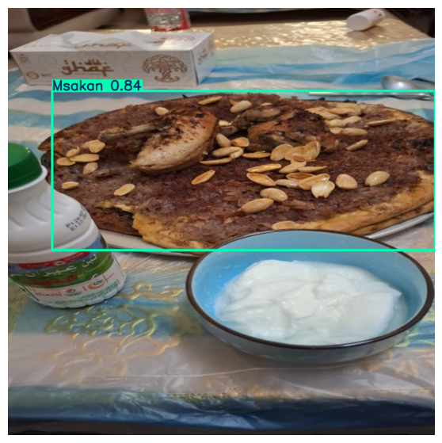 | |

## Model and recorded results

The main notebook trains a YOLOv8s detector for 130 epochs at 960-pixel image size. The table transcribes its saved evaluation output; it is not a new run from this repository.

| Notebook output | Images | Instances | Precision | Recall | mAP@0.50 | mAP@0.50:0.95 | F1 |
| --- | ---: | ---: | ---: | ---: | ---: | ---: | ---: |
| Separate evaluation | 825 | 786 | 74.2% | 83.5% | 80.9% | 64.7% | 78.6% |
| Training-cell summary | 8,615 | 9,798 | 83.7% | 83.4% | 88.8% | 69.7% | — |

The separate evaluation output lists 304 background images. The training-cell summary is a training diagnostic, not a held-out score: the shared YAML points both `train` and `val` to the same `food` directory. The evaluation cell scans a `test.cache` file but does not explicitly pass `split="test"`, and it loads `final_version.pt` while the training cell saves `YOLO_Trained_Model.pt`. The checkpoint and data split behind the separate evaluation therefore need confirmation. See the [full per-class evaluation and provenance notes](docs/model-evaluation.md).

## Classes

The dataset configuration lists 20 dishes: Pizza, Mansaf, Mjadra, Maqluba, Fasolia, Awameh, Salad, Molokhia, Shawarma, Macaroni, Burger, Kunafa, Dawali, Kabsa, Msakan, Qatayif, Cucumber with Yogurt, Mahashi, Coleslaw Salad, and Muhalabia.

## Project files

- [Main Colab notebook](https://colab.research.google.com/github/omar-salem23/smart-diet/blob/main/notebooks/Omar_Final_Project.ipynb) — training, evaluation, and notebook logs. It needs the original dataset and checkpoint in Drive; verify paths and splits before running.
- [`notebooks/Omar_Final_Project.ipynb`](notebooks/Omar_Final_Project.ipynb) — the notebook source saved in this repository.
- [`docs/model-evaluation.md`](docs/model-evaluation.md) — per-class metrics and evaluation caveats.
- [`configs/data1.drive.yaml`](configs/data1.drive.yaml) — configuration copied from Drive, with Drive-specific paths.
- [`configs/data1.example.yaml`](configs/data1.example.yaml) — portable example with separate train, validation, and test paths.
- [`assets/prediction-results/`](assets/prediction-results/) — annotated sample detections shown above.
- [`docs/Smart_Diet_Project_Presentation.pdf`](docs/Smart_Diet_Project_Presentation.pdf) — original project presentation.

The notebook uses Python, Ultralytics YOLO, OpenCV, and Matplotlib. The presentation proposes Streamlit and SQLite for a future application; runnable app source and trained model weights are not included.

## Project previews

| Application flow | Interface concept |
| --- | --- |
|  |  |

## Credits and use

Names listed in the presentation: **Omar Salem**, **Mohammed Abufurha**, **Hamzeh Haloub**, and **Dr. Ahmad Al-Smadi**.

Smart Diet is an educational project, not medical or nutrition advice. Any calorie estimate would depend on reliable dish recognition, portion size, and validated nutrition data; recommendations should be reviewed by a qualified nutrition professional.
