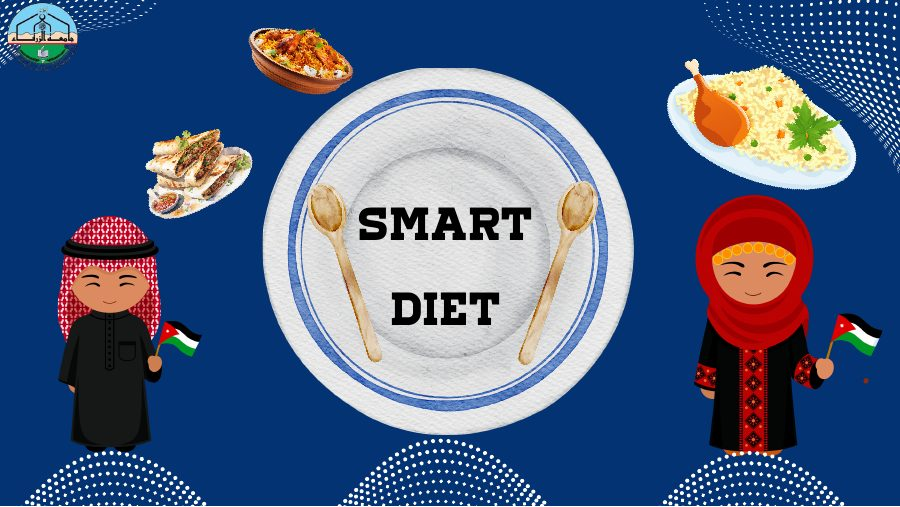
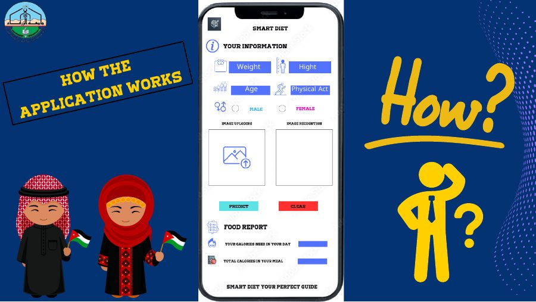
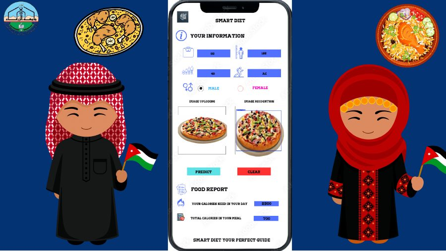

# Smart Diet

**Food image detection for Jordanian and Arabic cuisine, with a proposed calorie-tracking workflow.**

The project explores identifying dishes in meal photos and supporting a daily food log. Its presentation describes profile setup, meal recognition, calorie tracking, daily reports, and recommendations. The Colab notebook contains a YOLOv8s food-detection training run and saved evaluation output.

> **What this repository contains:** the project presentation, the main training notebook with its recorded output, the class configuration, and a few sample prediction inputs. The full food dataset, trained `.pt` checkpoint, and Streamlit/SQLite application source were not included in the shared Drive material. The notebook therefore cannot be rerun end-to-end from this repository alone.

## Food classes

The detector configuration lists 20 classes: Pizza, Mansaf, Mjadra, Maqluba, Fasolia, Awameh, Salad, Molokhia, Shawarma, Macaroni, Burger, Kunafa, Dawali, Kabsa, Msakan, Qatayif, Cucumber with Yogurt, Mahashi, Coleslaw Salad, and Muhalabia.

## Recorded model results

The final notebook records a YOLOv8s run of 130 epochs at 960-pixel image size, followed by a separate evaluation output. These are the metrics printed in the notebook:

| Notebook output | Images | Instances | Precision | Recall | mAP@0.50 | mAP@0.50:0.95 | F1 |
| --- | ---: | ---: | ---: | ---: | ---: | ---: | ---: |
| Separate evaluation | 825 | 786 | 74.2% | 83.5% | 80.9% | 64.7% | 78.6% |
| Training-cell summary | 8,615 | 9,798 | 83.7% | 83.4% | 88.8% | 69.7% | — |

The evaluation output also lists 304 background images. Full per-class values are in the [evaluation report](docs/model-evaluation.md).

These are transcribed notebook outputs; they have not been reproduced from the dataset in this repository.

**Read the evaluation caveat before interpreting these numbers:** the shared `data1.yaml` currently points both `train` and `val` to the same `food` directory, while the evaluation output scans a `test.cache` file. The training cell saves `Model/YOLO_Trained_Model.pt`, but the later evaluation cell loads `final_version.pt`. The data split and checkpoint used for each output therefore need confirmation before these metrics can be treated as a verified held-out benchmark.

## Qualitative prediction output

The notebook's inference cell is written to draw prediction boxes over the photos in `Data_prediction`. However, the saved cell output in the shared notebook is marked **“Output hidden”** and contains no rendered images. The four photos copied into [`assets/prediction-inputs/`](assets/prediction-inputs/) are original inputs only; they are not model predictions. The shared Drive material also did not include the `.pt` checkpoint needed to recreate the overlays.

## Notebook and configuration

- [Open the main Colab notebook](https://colab.research.google.com/github/omar-salem23/smart-diet/blob/main/notebooks/Omar_Final_Project.ipynb). Running it requires the original dataset and checkpoint in Drive, and the paths/splits should be checked first.
- [`notebooks/Omar_Final_Project.ipynb`](notebooks/Omar_Final_Project.ipynb) — YOLOv8s training, evaluation, and notebook outputs.
- [`configs/data1.drive.yaml`](configs/data1.drive.yaml) — the configuration copied from Drive, including its Drive-specific paths.
- [`configs/data1.example.yaml`](configs/data1.example.yaml) — a portable template with separate train, validation, and test directories.
- [`docs/Smart_Diet_Project_Presentation.pdf`](docs/Smart_Diet_Project_Presentation.pdf) — the original 14-page project presentation.

The presentation proposes **Ultralytics YOLO**, **SQLite**, and **Streamlit** for a future application. The notebook uses Python, Ultralytics, OpenCV, and Matplotlib. No runnable application code or trained checkpoint is included here.

## Project previews

| Application flow | Interface concept |
| --- | --- |
|  |  |

## Credits

Names listed in the presentation: **Omar Salem**, **Mohammed Abufurha**, **Hamzeh Haloub**, and **Dr. Ahmad Al-Smadi**.

## Nutrition note

Calorie estimates depend on dish recognition, portion size, and validated nutrition data. The equations and recommendations in the presentation need review by a qualified nutrition professional before use. Smart Diet is an educational project, not medical or nutrition advice.
